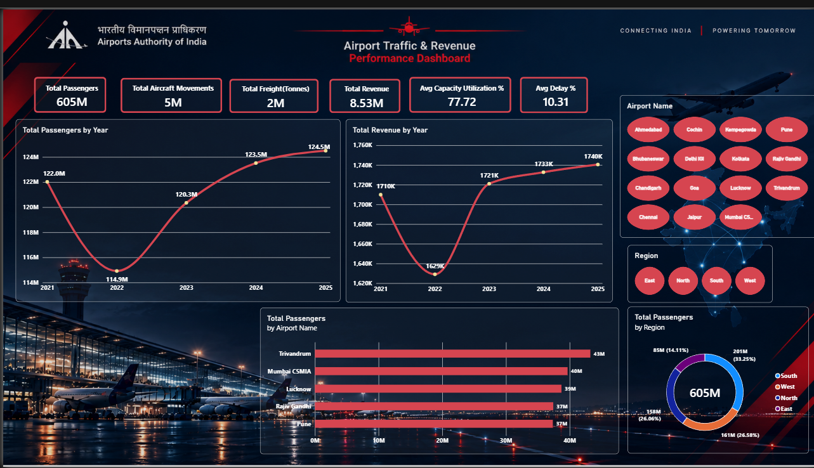
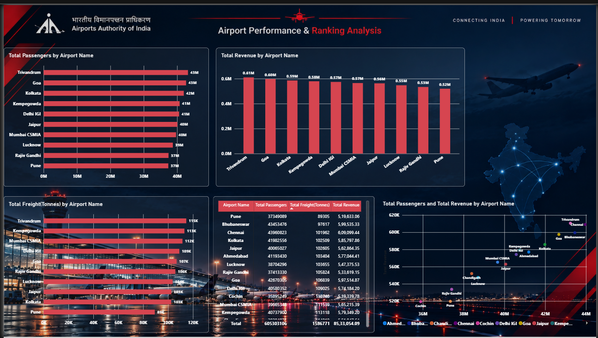
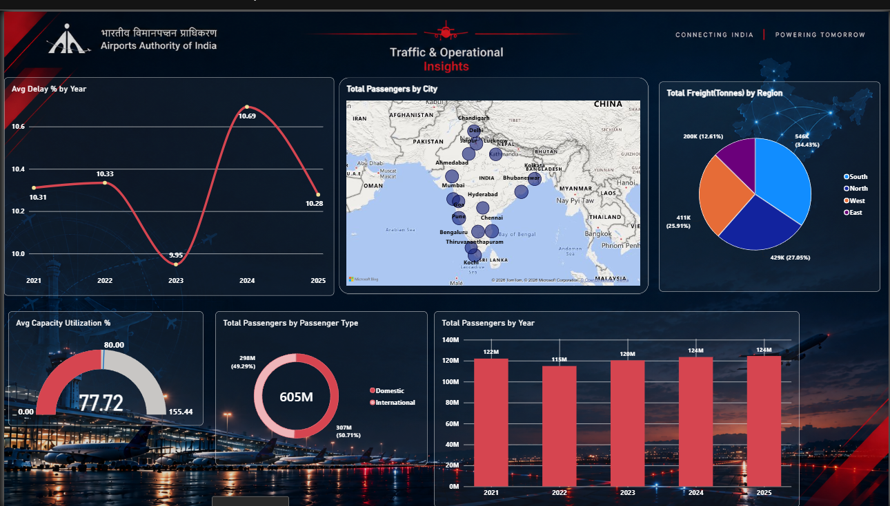

# Airport Authority of India Analytics Dashboard

## Project Overview

The Airport Authority of India Analytics Dashboard is an
interactive Power BI project designed to analyze airport
traffic, revenue, passenger volumes, freight, and operational
performance across India.

The dashboard transforms airport-related data into meaningful
visual insights to support performance monitoring and
comparative analysis.

## Project Objectives

- Analyze passenger traffic across airports.
- Compare airport revenue and performance.
- Examine aircraft movements and freight volumes.
- Identify leading airports by passenger traffic.
- Analyze regional passenger and freight distribution.
- Monitor annual passenger traffic and operational trends.
- Explore airport performance using interactive visualizations.

## Tools & Technologies

- Microsoft Power BI
- Power Query
- DAX
- Microsoft Excel
- Data Cleaning and Transformation
- Data Visualization

## Dashboard Pages

### 1. Airport Traffic & Revenue Performance Dashboard

Highlights key performance indicators, annual passenger
traffic, annual revenue, airport-level passenger volumes,
and regional passenger distribution.

### 2. Airport Performance & Ranking Analysis

Compares airports by passenger traffic, revenue, and freight.
Includes a detailed airport performance table and a scatter
chart for comparing passenger volumes with revenue.

### 3. Traffic & Operational Insights

Analyzes annual average delays, passenger traffic by city,
regional freight distribution, capacity utilization,
passenger types, and yearly passenger trends.

## Dashboard Preview

### Page 1: Airport Traffic & Revenue Performance

### Page 2: Airport Performance & Ranking Analysis

### Page 3: Traffic & Operational Insights

## Key Metrics

The dashboard includes measures such as:

- Total Passengers
- Total Aircraft Movements
- Total Freight
- Total Revenue
- Average Capacity Utilization
- Average Delay

## Data Sources

The project uses airport-related data for traffic,
revenue, freight, and operational analysis.

The original dataset sources, reporting periods, and
attribution details should be documented here.

## How to Use

1. Download the Power BI file from the Dashboard folder.
2. Open it using Microsoft Power BI Desktop.
3. Ensure the required source datasets are available.
4. Update data source paths if necessary.
5. Refresh the data and explore the dashboard pages.

## Key Learnings

- Data cleaning and transformation using Power Query.
- Creating DAX measures and calculated columns.
- Data modeling and relationship management.
- Designing interactive Power BI dashboards.
- Comparing airport performance using KPIs.
- Presenting business insights through visualizations.

## Author

Trisham Gautam

Aspiring Data Analyst | Power BI | SQL | Advanced Excel
